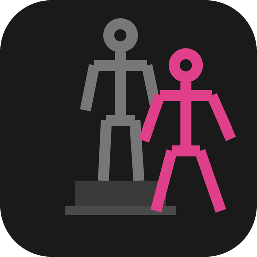
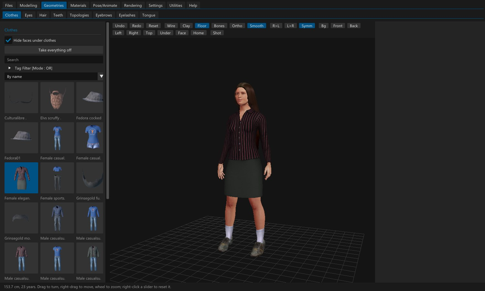

[](https://x.com/NorowaretaGemu)
[](https://www.gnu.org/licenses/agpl-3.0)

<br>
<div align="center">
  <a href="https://ko-fi.com/cursedentertainment">
    
  </a>
</div>
<br>
<div align="center">
  
  
  
</div>
<div align="center">
  
  
  
</div>
<br>

<div align="center">
  
</div>

# Pygmalion

**People in 3D with sliders, on your own PC.** [MakeHuman](https://github.com/makehumancommunity/makehuman) remade
in C++: the same body, the same 1,280 shapes, the same tabs, files and exports, in one small program that starts in a
second. Shape anyone with sliders (or describe them in words), dress them, pose them, give them a face, and take them
into Blender, Unity, Unreal or a 3D printer. Part of **[Atelier](https://github.com/CursedPrograms/Atelier)**,
Cursed Entertainment's creative suite. **[Website](https://cursedprograms.github.io/Pygmalion/)**



## Features

MakeHuman's own layout, tab for tab:

- **Files:** Load, Save and Export. Models are MakeHuman's `.mhm` files, both ways (MakeHuman opens Pygmalion's and
  the other way round), with a picture of each beside it.
- **Modelling:** Main (gender, age, muscle, weight, height, proportions, the three ethnicities, breasts), Gender,
  Face, Torso, Arms and Legs, Body shapes and Measure (real centimetres or inches), every one of MakeHuman's sliders
  with its picture, the view turning to what each slider changes. Custom targets of your own as sliders, and Random.
- **Geometries:** Clothes (several at once; the body under them is hidden), Eyes, Hair, Teeth, Topologies (low-poly
  bodies), Eyebrows, Eyelashes and Tongue, from MakeHuman's asset pack.
- **Materials:** every skin (young, middle-aged and old, each in several ethnicities), eye colours, and each worn
  thing's own materials.
- **Pose/Animate:** four skeletons (default, without toes, game engine, CMU motion capture), 18 poses, 33 facial
  expressions plus a mixer with every face pose unit as a slider, animations that play (and BVH motion capture in CMU
  or Mixamo naming), Show the bones.
- **Rendering:** pictures at any size up to 8K with anti-aliasing and a transparent background; MakeHuman's Scene:
  ambient light, shine and up to four lights (direction, colour, strength, fixed or turning with the view), five
  ready-made scenes and your own saved as `.pygscene`; the background; an orthographic view.
- **Exports:** Collada (`.dae`), FBX, glTF (`.glb`), OBJ, Ogre3D, STL, BVH and the UV map, with the skeleton, its
  weights and the textures, posed or not, feet on the ground, in any units. Collada, FBX and OBJ keep MakeHuman's
  four-sided faces and shared vertices (glTF, STL and Ogre3D only take triangles). Tested by importing into Blender.
- **Utilities:** Describe ("a tall, muscular old woman with a big nose" sets the sliders), Symmetry, Statistics,
  Material Editor, Expression mixer (save your own mixes as `.mhpose`), Targets, Save targets, Mass produce (hundreds of random people, saved and
  exported), Shell (one command at a time, with history), Scripting (Pygmalion's own commands for every job), Download (MakeHuman's 60+ community asset packs,
  CC0 and CC-BY: clothes, hair, shoes, hats, poses, skins; and anything downloaded from MakeHuman's community site,
  a zip or a folder, installed where it belongs: hair, eyebrows, eyelashes, teeth and the rest are told apart by
  where they sit on the body), Data and Logs. MakeHuman's own data folder is read too.
- **The toolbar:** Undo and Redo (shapes, clothes, skin and pose), Reset, Wire, Clay, Floor, Bones, Ortho, Smooth
  (MakeHuman's subdivision), symmetry, and the camera's views.
- **Settings:** slider behaviour and pictures, units, a background picture to model against, mouse speeds and
  inverting, and MakeHuman's shortcuts (Ctrl+S save, Ctrl+E export, 1/3/7 front/side/top...). Kept between runs.

## Minimum requirements

| | |
| --- | --- |
| **System** | Windows 10 or 11, 64-bit |
| **Processor** | any 64-bit processor |
| **Memory** | 4 GB RAM |
| **Graphics** | any graphics card with OpenGL 3.3 (2010 or newer) |
| **Disk** | 500 MB |

## Download and run

Windows: **Pygmalion-setup.exe** from [Releases](https://github.com/CursedPrograms/Pygmalion/releases) installs it
for you (no administrator needed) with Start menu and Desktop shortcuts. Or unzip **Pygmalion-win64.zip** anywhere and
run `Pygmalion.exe`, or get it through the [Atelier launcher](https://github.com/CursedPrograms/Atelier). MakeHuman's
body, shapes and asset pack come with it.

Models go into `Documents\Pygmalion` (or `Pygmalion` in your user folder when Windows guards Documents); downloaded
asset packs and your own targets go into its `data` and `custom` folders.

**Scripting:** a line each, run from Utilities > Scripting or with `Pygmalion.exe --script file.pyg`:

```
reset
macro Gender 0
macro Age 0.4
wear hair/bob01/bob01.mhclo
skin skins/young_caucasian_female/young_caucasian_female.mhmat
skeleton game_engine
pose standing01
expression smile01
export C:/models/her.fbx
render C:/models/her.png 1920 1080
```

## Build

Windows: Visual Studio 2022 (C++), CMake and [Inno Setup 6](https://jrsoftware.org/isinfo.php); then `build.bat` (or
`build.ps1`). It fetches SDL2 and MakeHuman's asset pack (CC0) the first time, and packs `dist/Pygmalion-win64.zip`
and `dist/Pygmalion-setup.exe`. `install.bat` / `install.ps1` install the build.

Linux: `./build.sh` (cmake, a C++17 compiler, libsdl2-dev).

The code, in `src/`:
- `human.cpp`: the body, its targets and modifiers, macros, proxies (clothes and the rest), `.mhm` files, Describe
- `skeleton.cpp`: skeletons, poses, skinning, BVH in and out, retargeting other skeletons' motion
- `export.cpp`: Collada, FBX, Ogre3D and the UV map
- `model.cpp`: glTF, OBJ and STL
- `viewer.cpp`: the 3D view (OpenGL 3.3): MakeHuman's litsphere skin, textures, Smooth, the bones, renders
- `gui.cpp`: the window (SDL2, Dear ImGui): MakeHuman's categories and tabs, scripting, the asset downloader
- `splash.cpp`: the splash shown while the 1,280 shapes load

## Credits

Pygmalion ports [MakeHuman](https://github.com/makehumancommunity/makehuman)'s code (AGPL-3.0), so it is AGPL-3.0
too. The body, its shapes, the clothes, hair, skins and the rest are MakeHuman's assets (CC0); the poses, expressions,
skeletons and animations come from MakeHuman 1.1.1. Built with [SDL2](https://www.libsdl.org),
[Dear ImGui](https://github.com/ocornut/imgui) and [stb](https://github.com/nothings/stb). See [NOTICE](NOTICE).

<br>
<div align="center">
<a href="https://cursedprograms.github.io/Pygmalion/" target="_blank">
    
</a>
</div>

---
<br>
<div align="center">
<a href="https://github.com/Farica-Kimora">Farica☆Kimora</a> © Cursed Entertainment 2026
</div>
<br>
<div align="center">
<a href="https://cursed-entertainment.itch.io/" target="_blank">
    
</a>
</div>
